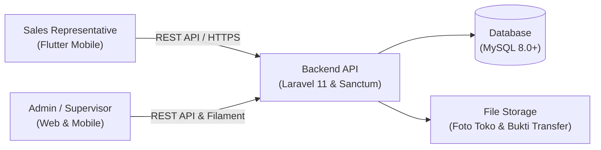

# M21 Sales App

[](https://flutter.dev)
[](https://laravel.com)
[](https://www.mysql.com)
[](#)
[](#)

**M21 Sales App** adalah sistem *Sales Force Automation* (SFA) dan distribusi terpadu yang dirancang untuk mengoptimalkan efisiensi, transparansi, dan akurasi tim penjualan lapangan (*Field Sales / Canvassing / Taking Order*) di **PT M21**. 

Aplikasi ini mengintegrasikan aplikasi mobile (**Flutter**) untuk sales di lapangan dan manajemen di ponsel, serta Web Panel (**Laravel Filament**) untuk administrasi dan analisis data terpusat.

---

## Daftar Isi
- [Latar Belakang & Tujuan](#-latar-belakang--tujuan)
- [Fitur Utama](#-fitur-utama)
- [Aturan Bisnis Kunci](#-aturan-bisnis-kunci)
- [Arsitektur & Tech Stack](#-arsitektur--tech-stack)
- [Struktur Proyek](#-struktur-proyek)
- [Dokumentasi Lengkap](#-dokumentasi-lengkap)
- [Panduan Memulai (Getting Started)](#-panduan-memulai-getting-started)

---

## Latar Belakang & Tujuan
Proses penjualan konvensional seringkali menghadapi kendala berupa duplikasi penawaran antar-sales, ketidakpastian kehadiran sales di toko fisik, serta pencatatan piutang tempo yang sulit dipantau. 

**M21 Sales App** menyelesaikan permasalahan tersebut dengan:
1. **Mencegah Konflik Wilayah:** Menjamin setiap toko dibina secara eksklusif oleh satu sales.
2. **Validasi Kunjungan Real:** Memastikan sales benar-benar berada di lokasi fisik toko sebelum mengambil pesanan melalui verifikasi GPS.
3. **Automasi Pemesanan & Pembayaran:** Mempermudah input kuantitas barang multi-satuan, pengajuan diskon, serta pelacakan tagihan tempo yang *overdue*.

---

## Fitur Utama

### 1. Registrasi & Pemetaan Toko (Store Acquisition)
- Pendaftaran toko baru langsung dari lapangan: Nama Toko, Pemilik, No. Telepon unik, Alamat, dan 1 Foto Toko.
- **Dual Geotagging:** Deteksi otomatis koordinat GPS terkini (*Current Location*) atau geser penanda manual (*Pinpoint Marker*) pada peta.
- **Anti-Duplikasi Global:** Pengecekan otomatis keunikan nomor telepon pemilik toko di sistem.
- **Peta Teritori Cerdas:** Sales dapat melihat persebaran titik tokonya (akses penuh) dan titik toko milik rekan sales lain (*read-only* penanda wilayah).

### 2. Validasi Kunjungan Lapangan (Geofencing Check-in)
- Tombol **"Mulai Kunjungan"** sebelum membuat order di toko lama.
- Validasi radius otomatis menggunakan formula *Haversine* ($\le 100\text{ meter}$).
- Mencegah manipulasi pesanan fiktif dari luar lokasi toko.

### 3. Pengambilan Pesanan Fleksibel (Taking Order)
- Katalog produk resmi dikelola terpusat oleh Admin.
- Pilihan satuan kuantitas: `pcs`, `pack`, atau `box`.
- **Toggle Sakelar Diskon:** Tombol *ON/OFF* permintaan diskon toko (sales tidak memasukkan persentase; status *ON* menjadi sinyal bagi Admin untuk mengevaluasi dan menetapkan persentase diskon).
- **Auto-Approved:** Pesanan langsung tersimpan dan diteruskan ke antrean kerja admin.
- **Sales Flexibility:** Sales berhak mengedit atau membatalkan pesanan yang telah dikirim kapan saja.
- **Tanpa Batas Stok Klien:** Pemesanan mengadopsi model *pre-order* tanpa pemblokiran stok kosong di aplikasi.

### 4. Multi-Channel Pembayaran & Pelacakan Piutang
- **Cash (Tunai):** Pembayaran langsung di tempat.
- **Tempo 14 Hari (Kredit):** Pembayaran berjangka. Sistem otomatis mendeteksi dan mengubah status menjadi **Overdue** jika lewat dari 14 hari kalender.
- **Transfer Bank:** Rekening resmi **BRI: 300601003045505** dengan kewajiban unggah foto bukti transfer oleh sales.

### 5. Dashboard Admin & Ekspor Excel
- Akses ganda: **Web Dashboard (Laravel Filament)** & **Mobile Admin (Flutter)**.
- Monitoring pesanan masuk, verifikasi bukti transfer, dan filter tagihan *overdue*.
- **Ekspor Data ke `.xlsx` (Excel):** Unduh rekapitulasi transaksi penjualan, laporan piutang, dan master toko untuk pelaporan manajerial.

---

## Aturan Bisnis Kunci
| Kode | Aturan Bisnis | Deskripsi |
| :--- | :--- | :--- |
| **BR-01** | *Exclusive Store Assignment* | Satu toko hanya dapat dikelola dan diorder oleh 1 sales penanggung jawab. |
| **BR-02** | *Unique Phone Check* | Pendaftaran toko ditolak jika nomor kontak pemilik toko sudah terdaftar di sistem. |
| **BR-03** | *GPS Radius Check-in* | Form pesanan hanya terbuka jika sales berhasil check-in dalam radius $\le 100\text{ meter}$. |
| **BR-04** | *Discount Evaluation* | Permintaan diskon dari sales berupa sakelar *ON/OFF*; penentuan persentase diskon diputuskan oleh Admin. |
| **BR-05** | *Overdue Automation* | Tagihan tempo yang belum dibayar dalam $14\text{ hari}$ otomatis berstatus *Overdue*. |
| **BR-06** | *Simplified Succession* | Jika sales resign, cukup ubah data/nama akun pengguna agar riwayat toko binaan tetap terjaga. |

---

## 🛠️ Arsitektur & Tech Stack



- **Mobile Client:** [Flutter](https://flutter.dev) (Dart)
- **State Management:** Provider / BLoC / Riverpod
- **Maps & Geolocation:** `geolocator`, `google_maps_flutter`
- **Backend Framework:** [Laravel 11.x](https://laravel.com) (PHP 8.2+)
- **Admin Panel:** [Laravel Filament v3](https://filamentphp.com)
- **Autentikasi:** Laravel Sanctum (Token-based RBAC: `sales` & `admin`)
- **Basis Data:** MySQL 8.0+
- **Reporting & Export:** `maatwebsite/excel` (Format `.xlsx`)

---

## Struktur Proyek
```text
m21_sales_app/
├── android/               # Konfigurasi native Android
├── docs/                  # Dokumentasi Proyek & Spesifikasi
│   └── SRS_M21_Sales_App.md # Software Requirements Specification (SRS)
├── lib/                   # Source code utama aplikasi Flutter
│   └── main.dart          # Entry point aplikasi
├── web/                   # Konfigurasi Flutter Web
├── pubspec.yaml           # Manajemen dependensi pustaka Flutter
└── README.md              # Informasi dan dokumentasi repositori
```

---

## Dokumentasi Lengkap
Dokumen spesifikasi teknis dan kebutuhan perangkat lunak lengkap (*Software Requirements Specification*) dapat dibaca pada:
**[Dokumen SRS M21 Sales App (docs/SRS_M21_Sales_App.md)](docs/SRS_M21_Sales_App.md)**

---

## Panduan Memulai (Getting Started)

### Prasyarat
1. [Flutter SDK](https://docs.flutter.dev/get-started/install) (versi 3.24.0 atau terbaru).
2. [Android Studio](https://developer.android.com/studio) / VS Code dengan ekstensi Flutter & Dart.
3. Git terpasang di komputer.

### Menjalankan Aplikasi Mobile
1. **Clone repositori:**
   ```bash
   git clone https://github.com/tikodjati/M21-Sales-App.git
   cd M21-Sales-App
   ```
2. **Unduh dependensi pub:**
   ```bash
   flutter pub get
   ```
3. **Jalankan aplikasi pada emulator atau perangkat fisik:**
   ```bash
   flutter run
   ```

---

## Pengembang & Lisensi
Dikembangkan untuk proyek **Praktikum Pemrograman Mobile - PT M21**.  
Seluruh hak cipta dan ketentuan operasional dimiliki oleh pengembang dan entitas M21.
