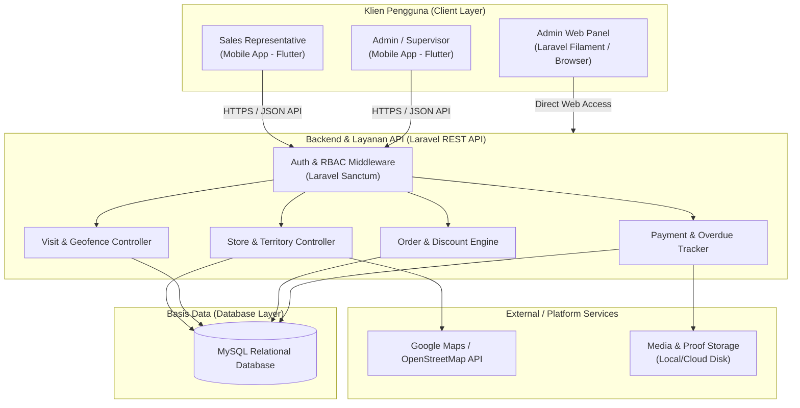
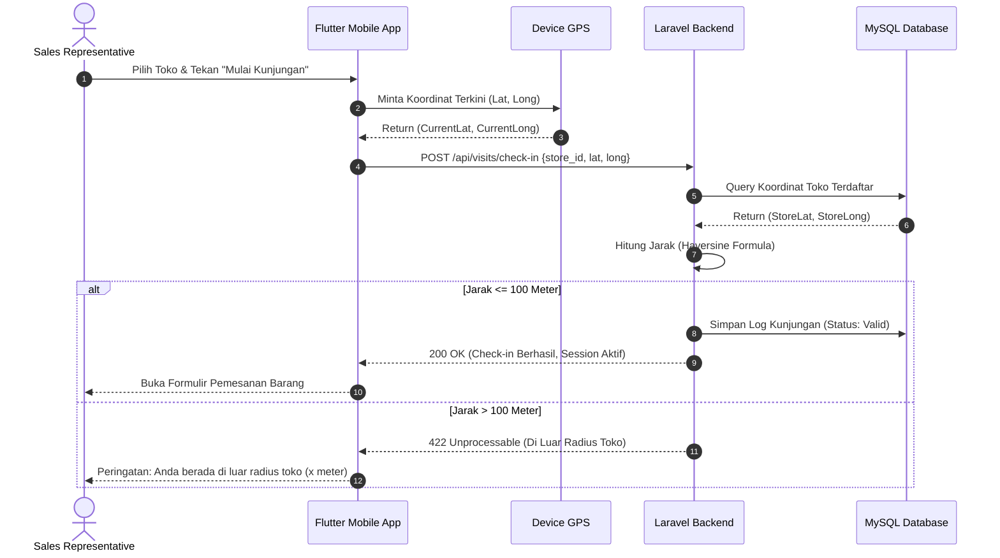
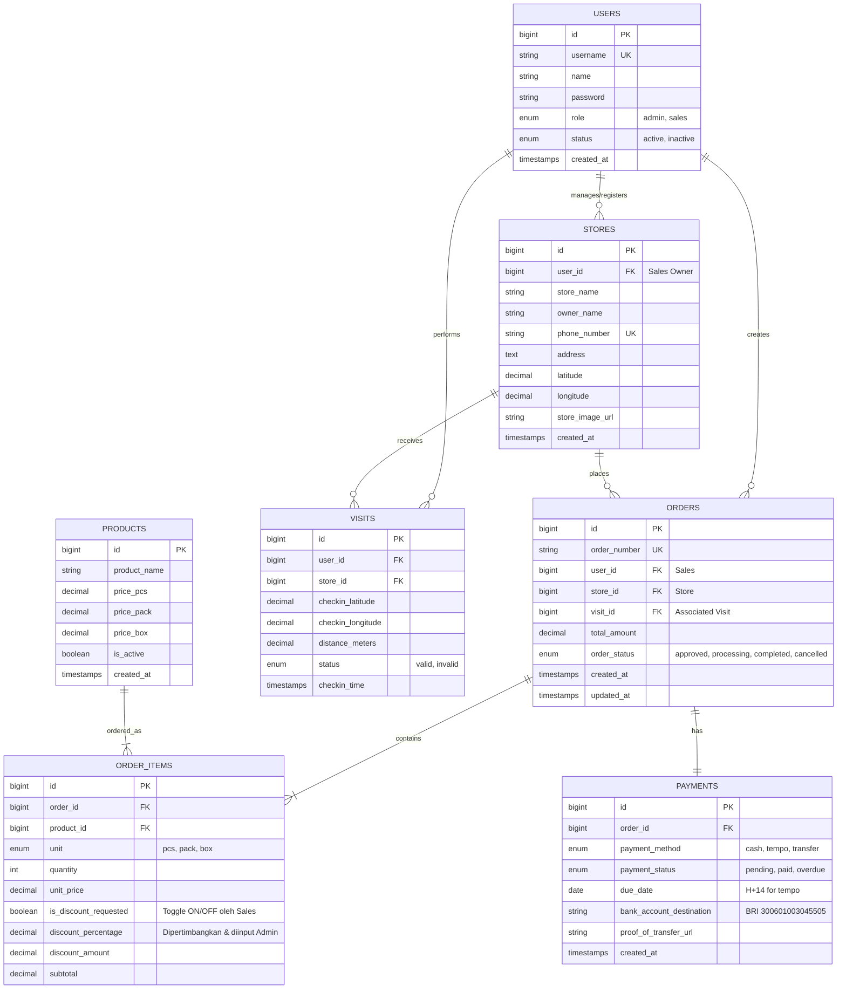

# SOFTWARE REQUIREMENTS SPECIFICATION (SRS)
## M21 SALES APP (SISTEM OTOMASI PENJUALAN LAPANGAN)

---

### DAFTAR INFORMASI DOKUMEN
| Item | Informasi |
| :--- | :--- |
| **Nama Proyek** | M21 Sales App |
| **Entitas Bisnis** | M21 Corporation |
| **Kategori Sistem** | Sales Force Automation (SFA) / Distribution & Account Management |
| **Versi Dokumen** | 1.0.0 |
| **Tanggal Pembuatan** | 17 November 2026 |
| **Status Dokumen** | Disetujui (Approved) |

---

## 1. PENDAHULUAN (INTRODUCTION)

### 1.1 Tujuan (Purpose)
Dokumen *Software Requirements Specification* (SRS) ini merinci seluruh spesifikasi fungsional, non-fungsional, dan arsitektur sistem untuk pengembangan **M21 Sales App**. Dokumen ini menjadi acuan tunggal bagi tim pengembang (*software engineering*), penguji (*QA*), dan pihak pemangku kepentingan (*stakeholders*) dalam membangun solusi otomasi penjualan berbasis mobile dan web.

### 1.2 Ruang Lingkup Sistem (Product Scope)
M21 Sales App dirancang untuk mengoptimalkan operasional tim penjualan lapangan (*Field Sales / Canvassing / Taking Order*) di PT M21 dengan **wilayah operasional utama di Daerah Istimewa Yogyakarta (DIY)** (mencakup Kota Yogyakarta, Kabupaten Sleman, Kabupaten Bantul, Kabupaten Kulon Progo, dan Kabupaten Gunungkidul). Sistem ini memfasilitasi:
1. Akuisisi dan pemetaan toko baru (*Customer Acquisition & Geotagging*).
2. Penerapan kepemilikan toko secara eksklusif (*Exclusive Store-Sales Assignment*) untuk mencegah konflik antar-sales.
3. Validasi kehadiran fisik sales saat kunjungan (*GPS Geofencing Check-in*).
4. Pembuatan pesanan barang (*Taking Order*) dengan fleksibilitas satuan (pcs, pack, box) dan pengajuan diskon.
5. Pengelolaan multi-metode pembayaran (Cash, Tempo 14 hari dengan deteksi *Overdue*, dan Transfer Bank BRI dengan unggah bukti transfer).
6. Akses manajerial terpusat bagi Admin melalui **Web Dashboard (Laravel Filament)** dan **Mobile App (Flutter)**.

### 1.3 Definisi, Akronim, dan Singkatan
- **SFA (Sales Force Automation):** Sistem perangkat lunak untuk mengotomatiskan proses pencatatan dan pelaporan kegiatan tim sales.
- **Geotagging:** Proses perekaman metadata geografis (garis lintang/latitude dan garis bujur/longitude) pada entitas toko.
- **Geofencing:** Pembatasan perimeter virtual di sekitar titik koordinat toko fisik untuk memvalidasi radius kehadiran fisik sales.
- **TOP (Term of Payment):** Kebijakan pembayaran berjangka/tempo (pada M21 ditetapkan 14 hari kalender).
- **Overdue:** Status piutang penjualan yang telah melampaui batas waktu tempo pembayaran (lebih dari 14 hari).
- **RBAC (Role-Based Access Control):** Mekanisme pembatasan hak akses sistem berdasarkan peran pengguna (*Sales* dan *Admin*).

---

## 2. DESKRIPSI KESELURUHAN (OVERALL DESCRIPTION)

### 2.1 Arsitektur Sistem (System Architecture)
Sistem M21 Sales App mengadopsi arsitektur *Client-Server* modern berbasis RESTful API:

### 2.2 Karakteristik & Peran Pengguna (User Roles)

| Peran (Role) | Platform Akses | Hak Akses & Tanggung Jawab Utama |
| :--- | :--- | :--- |
| **Sales Representative** | Mobile App (Flutter) | • Mendaftarkan toko baru beserta foto & koordinat peta. • Melihat persebaran toko miliknya & toko sales lain (*read-only*). • Melakukan check-in kunjungan berbasis radius GPS. • Menginput, mengedit, dan membatalkan pesanan toko miliknya. • Memilih metode pembayaran (Cash/Tempo/TF) & upload bukti transfer. |
| **Admin / Supervisor** | Web Dashboard (Filament) & Mobile App (Flutter) | • Mengelola Master Data Produk (harga, satuan, kebijakan diskon). • Mengelola akun pengguna (membuat sales, mengganti nama sales saat resign/mutasi). • Memantau seluruh pesanan masuk secara real-time. • Memverifikasi pembayaran transfer & memantau tagihan tempo yang *overdue*. • Meninjau peta sebaran seluruh toko terdaftar. |

### 2.3 Batasan dan Asumsi Desain
- **Ketersediaan GPS:** Perangkat mobile sales wajib memiliki fitur GPS aktif dengan akurasi memadai untuk menjalankan fungsi registrasi dan check-in kunjungan.
- **Kamera Fisik:** Perangkat mobile wajib memiliki modul kamera aktif untuk pengambilan foto fisik toko dan foto struk bukti transfer.
- **Konektivitas Internet:** Aplikasi berjalan secara online terhubung ke REST API Laravel.

---

## 3. ATURAN BISNIS UTAMA (CORE BUSINESS RULES)

1. **BR-01 (Store Exclusivity):** Setiap toko terdaftar terikat secara eksklusif ke satu Sales Representative (pembuat data). Sales lain hanya dapat melihat titik toko tersebut sebagai penanda teritori, namun **dilarang keras** membuat order, mengedit data toko, atau melakukan kunjungan pada toko tersebut.
2. **BR-02 (Anti-Duplication via Phone):** Nomor telepon pemilik toko bersifat unik secara global di database. Pendaftaran toko baru dengan nomor telepon yang sudah ada akan ditolak secara otomatis oleh sistem.
3. **BR-03 (Visit Geofencing):** Pembuatan pesanan untuk toko lama hanya dapat dibuka jika sales telah sukses melakukan *Check-in Kunjungan* dalam radius validasi ($\le 50 - 100\text{ meter}$) dari titik koordinat toko.
4. **BR-04 (Zero Stock Constraint):** Penginputan pesanan oleh sales tidak dibatasi oleh sisa stok fisik di sistem (*Pre-Order / Infinite Quota Fulfillment*). Pemenuhan dan ketersediaan barang diatur secara internal oleh tim logistik/admin.
5. **BR-05 (Auto-Approved Order Lifecycle):** Setiap pesanan yang dikirim sales langsung berstatus disetujui (*Auto-Approved*) dan masuk ke antrean pemrosesan admin.
6. **BR-06 (Sales Order Reversibility):** Sales memiliki wewenang untuk mengubah (*edit*) kuantitas atau membatalkan (*cancel*) pesanan yang telah dikirim kapan saja.
7. **BR-07 (Payment Channels & Overdue):**
   - Transaksi transfer bank wajib ditujukan ke rekening **BRI: 300601003045505** disertai unggahan bukti transfer.
   - Transaksi tempo berjangka waktu 14 hari kalender. Jika pembayaran belum diselesaikan setelah hari ke-14, sistem secara otomatis mengubah status menjadi **Overdue**.
8. **BR-08 (Simplified Sales Reassignment):** Pengalihan akun saat sales mengundurkan diri (*resign*) dilakukan dengan memperbarui data identitas/nama akun sales terkait, sehingga seluruh toko binaan tetap melekat pada entitas akun tersebut.

---

## 4. KEBUTUHAN FUNGSIONAL SISTEM (FUNCTIONAL REQUIREMENTS)

### 4.1 Modul Autentikasi & Akun (AUTH)
- **FR-AUTH-01:** Sistem menyediakan fitur login menggunakan kredensial (Username & Password, tanpa menggunakan email).
- **FR-AUTH-02:** Sistem menerapkan mekanisme Role-Based Routing setelah login (Sales diarahkan ke antarmuka operasional mobile, Admin diarahkan ke antarmuka manajerial/dashboard).
- **FR-AUTH-03:** Admin dapat mengubah informasi nama dan profil akun sales untuk keperluan suksesi/penggantian sales baru tanpa memutus riwayat toko.

### 4.2 Modul Registrasi & Manajemen Toko (TOKO)
- **FR-TOKO-01:** Sales dapat mendaftarkan toko baru dengan atribut data:
  1. Nama Toko (Wajib)
  2. Nama Pemilik Toko (Wajib)
  3. Nomor Telepon / WhatsApp (Wajib, 1 nomor, unik)
  4. Alamat Lengkap Toko (Wajib)
  5. Titik Koordinat Latitude & Longitude (Wajib)
  6. Foto Fisik Toko (Wajib, 1 berkas gambar via kamera/galeri)
- **FR-TOKO-02 (Dual Geotagging):** Sistem mendukung penentuan koordinat secara:
  - *Otomatis:* Mengambil posisi GPS perangkat terkini (*Current Location*).
  - *Manual:* Sales dapat menggeser penanda (*pinpoint marker*) di peta interaktif atau mencari nama alamat.
- **FR-TOKO-03 (Pencegahan Duplikasi):** Sistem memeriksa keunikan nomor telepon pemilik toko. Jika terdeteksi duplikat, sistem menampilkan pesan peringatan: *"Toko sudah terdaftar di bawah pengelolaan [Nama Sales Pemilik]"*.
- **FR-TOKO-04 (Visibilitas Peta Teritori):**
  - Toko milik sales yang sedang login ditampilkan dengan pin/penanda khusus (misal: warna hijau/biru) yang memiliki aksi penuh (*Check-in*, *Order*, *Edit*).
  - Toko milik sales lain ditampilkan dengan pin pembeda (misal: warna abu-abu/kuning) bersifat *Read-Only* (hanya menampilkan nama toko & nama sales penanggung jawab, tanpa tombol order/check-in).

### 4.3 Modul Kunjungan Lapangan & Geofencing (VISIT)
- **FR-VISIT-01:** Sebelum membuat pesanan di toko yang sudah terdaftar, sales wajib menekan tombol **"Mulai Kunjungan / Check-in"**.
- **FR-VISIT-02:** Sistem menghitung jarak Euclidean / Haversine antara koordinat perangkat sales saat ini dengan koordinat toko yang tersimpan di database.
- **FR-VISIT-03:** Jika jarak $\le 100\text{ meter}$, check-in dinyatakan berhasil dan sesi order terbuka. Jika $> 100\text{ meter}$, sistem menolak aksi dan menginstruksikan sales untuk mendekat ke lokasi toko fisik.

### 4.4 Modul Master Produk & Kebijakan Diskon (PROD)
- **FR-PROD-01:** Admin mengelola Master Produk (Tambah, Ubah, Hapus, Nonaktifkan) melalui Web Dashboard / Mobile.
- **FR-PROD-02:** Atribut produk mencakup: Nama Barang, Deskripsi, Satuan Dasar, dan Konfigurasi Harga per Satuan (`pcs`, `pack`, `box`).
- **FR-PROD-03:** Admin dapat mengatur skema diskon khusus atau diskon per produk untuk toko tertentu.
- **FR-PROD-04:** Sales dapat membaca daftar katalog produk yang berstatus aktif tanpa ada validasi pemblokiran stok (*No Out-of-Stock lock*).

### 4.5 Modul Pemesanan (Sales Order / Taking Order) (ORD)
- **FR-ORD-01:** Sales dapat memilih beberapa produk ke dalam keranjang pesanan.
- **FR-ORD-02:** Untuk setiap item barang, sales menentukan:
  - Satuan yang dipesan: pilihan `pcs`, `pack`, atau `box`.
  - Jumlah kuantitas (*Quantity*).
  - Opsi *Permintaan Diskon*: berupa tombol sakelar / *toggle on-off* (default: *OFF* / `false`). Sales **tidak menginput persentase diskon**. Jika tombol diaktifkan (*ON* / `true`), pesanan tersebut memberikan sinyal khusus kepada Admin bahwa toko meminta diskon, sehingga Admin dapat mempertimbangkan dan menginputkan besaran persentase diskon yang disetujui.
- **FR-ORD-03:** Sistem menghitung kalkulasi harga secara otomatis:
  $$\text{Subtotal Item} = (\text{Harga Satuan} \times \text{Qty}) - \text{Diskon yang disetujui Admin}$$
  $$\text{Grand Total} = \sum \text{Subtotal Item}$$
  *(Catatan: Sebelum Admin menetapkan persentase diskon untuk item yang di-request, nilai diskon awal adalah Rp 0).*
- **FR-ORD-04 (Auto-Approved):** Saat pesanan disubmit oleh sales, status pesanan langsung ditetapkan sebagai `Disetujui / Menunggu Pengiriman` tanpa memerlukan verifikasi manual approval.
- **FR-ORD-05 (Hak Edit & Cancel):** Sales memiliki hak penuh untuk mengubah kuantitas/item pesanan atau membatalkan (*cancel*) pesanan yang telah dikirim kapan saja melalui riwayat pesanan.

### 4.6 Modul Pembayaran & Manajemen Piutang (PAY)
- **FR-PAY-01:** Sistem mendukung 3 metode pembayaran:
  1. **Cash (Tunai):** Pembayaran langsung saat transaksi/pengantaran.
  2. **Tempo (Term of Payment 14 Hari):** Transaksi kredit dengan tanggal jatuh tempo = $\text{Tanggal Transaksi} + 14\text{ hari}$.
  3. **Transfer Bank:** Pembayaran non-tunai melalui transfer rekening.
- **FR-PAY-02 (Informasi Transfer):** Pada pilihan transfer bank, antarmuka aplikasi secara eksplisit menampilkan informasi rekening tujuan:
  - **Nama Bank:** PT Bank Rakyat Indonesia (Persero) Tbk (BRI)
  - **Nomor Rekening:** `300601003045505`
  - **Kewajiban Bukti:** Sales wajib mengunggah 1 foto struk/tangkapan layar bukti transfer.
- **FR-PAY-03 (Automated Overdue Check):** Sistem memiliki *background job / cron scheduler* harian yang memeriksa seluruh pesanan tempo belum lunas. Jika:
  $$\text{Current Date} > \text{Tanggal Jatuh Tempo (H+14)}$$
  Maka status pembayaran secara otomatis diperbarui dari `Tempo (Active)` menjadi **`Overdue`**.
- **FR-PAY-04:** Admin dapat menandai tagihan tempo yang telah dilunasi menjadi `Lunas`.

### 4.7 Modul Dashboard & Monitoring Admin (ADM)
- **FR-ADM-01 (Web Panel - Laravel Filament):**
  - Tabel pemantauan seluruh order masuk beserta status pembayaran dan pengiriman.
  - Filter khusus daftar tagihan tempo berstatus `Overdue`.
  - Pratinjau (*preview*) foto bukti transfer bank.
  - Peta digital persebaran seluruh toko terdaftar beserta nama sales yang mengelolanya.
  - Laporan rekapitulasi penjualan per periode dan per sales.
- **FR-ADM-02 (Mobile Admin - Flutter):**
  - Tampilan ringkas metrik penjualan harian (Total Omzet, Total Order, Toko Baru).
  - Monitoring daftar order terbaru dan status tagihan *overdue*.
- **FR-ADM-03 (Ekspor Laporan ke Excel / XLSX):**
  - Sistem menyediakan fitur ekspor data dalam format berkas spreadsheet `.xlsx` (Microsoft Excel) melalui Web Dashboard Admin.
  - Data yang dapat diekspor mencakup:
    1. Rekapitulasi transaksi penjualan & item pesanan (dengan opsi filter periode tanggal, status order, dan sales penanggung jawab).
    2. Laporan pembayaran & monitoring piutang jatuh tempo (*Overdue*).
    3. Daftar data master toko terdaftar beserta pemilik dan sales pembinanya.

---

## 5. SKEMA BASIS DATA (DATA DESIGN & ERD)

---

## 6. KEBUTUHAN NON-FUNGSIONAL (NON-FUNCTIONAL REQUIREMENTS)

### 6.1 Kinerja (Performance)
- **NFR-PERF-01:** Waktu respons API rata-rata $\le 1.5\text{ detik}$ pada kondisi jaringan mobile 4G standar.
- **NFR-PERF-02:** Kompresi gambar otomatis pada sisi mobile client sebelum unggah (maksimum ukuran foto toko dan bukti transfer $\le 1\text{ MB}$) untuk menghemat *bandwidth*.

### 6.2 Keamanan & Integritas Data (Security)
- **NFR-SEC-01:** Seluruh komunikasi data mobile-ke-server wajib menggunakan protokol enkripsi HTTPS/TLS 1.3.
- **NFR-SEC-02:** Autentikasi API menggunakan bearer token berbasis **Laravel Sanctum**.
- **NFR-SEC-03:** Validasi server-side ketat untuk seluruh operasi pembuatan order guna mencegah sales membuat transaksi pada toko milik sales lain.
- **NFR-SEC-04:** Penyimpanan kata sandi wajib menggunakan algoritma *hashing* standar industri (`bcrypt` atau `Argon2id`).

### 6.3 Keandalan & Ketersediaan (Reliability & Availability)
- **NFR-REL-01:** Layanan backend ditargetkan memiliki ketersediaan (*uptime*) minimal $99.0\%$ selama jam operasional penjualan (07:00 – 19:00 WIB).
- **NFR-REL-02:** Mekanisme penanganan error yang ramah pengguna pada aplikasi mobile saat terjadi kehilangan koneksi internet tiba-tiba.

### 6.4 Kompatibilitas Antarmuka & Perangkat (Compatibility)
- **NFR-COMP-01:** Aplikasi mobile Flutter mendukung sistem operasi Android versi minimal 8.0 (Oreo / API Level 26) hingga Android 14+.
- **NFR-COMP-02:** Web Dashboard Filament dapat diakses secara responsif menggunakan peramban modern (Google Chrome, Mozilla Firefox, Safari, Microsoft Edge).

---

## 7. RENCANA IMPLEMENTASI TEKNIS (TECH STACK & TOOLS)

| Komponen Arsitektur | Teknologi / Pustaka yang Digunakan |
| :--- | :--- |
| **Mobile Client** | **Flutter (Dart)** |
| **Mobile Maps & Location** | `google_maps_flutter` / `flutter_map`, `geolocator` |
| **Mobile Image Handling** | `image_picker`, `flutter_image_compress` |
| **State Management** | Provider / BLoC / Riverpod |
| **Backend REST API** | **Laravel 11.x (PHP 8.2+)** |
| **Admin Web Dashboard** | **Laravel Filament v3** |
| **Excel Export Engine** | `maatwebsite/excel` / Filament Actions Export (`.xlsx`) |
| **API Authentication** | Laravel Sanctum |
| **Database** | MySQL 8.0+ |
| **Scheduled Tasks** | Laravel Task Scheduling (Cron Job untuk kalkulasi status *Overdue*) |

---

*Dokumen ini sah dan disepakati sebagai acuan teknis pengembangan sistem M21 Sales App.*
